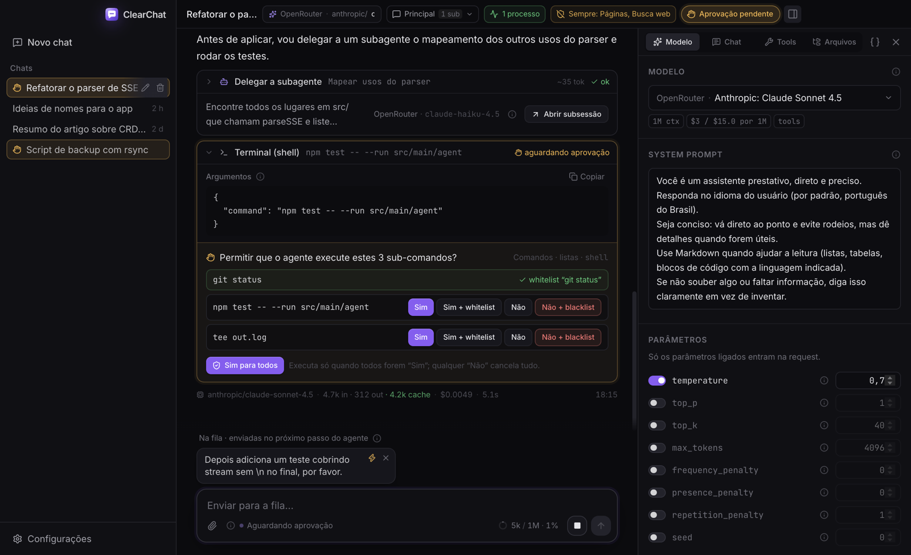
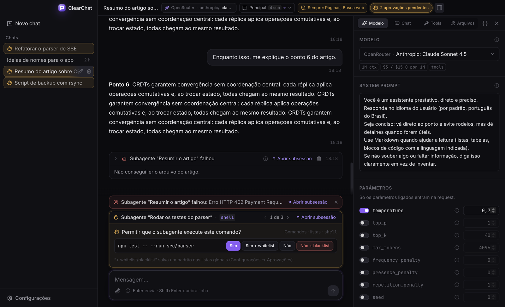
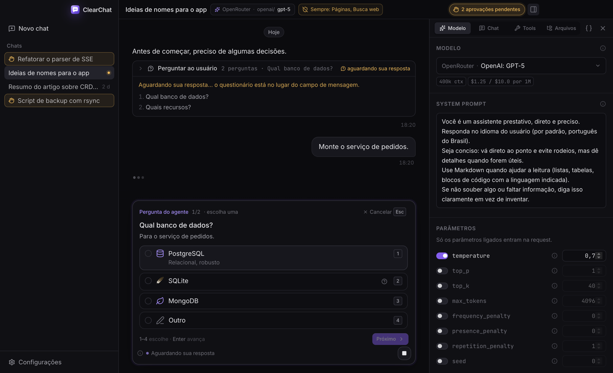
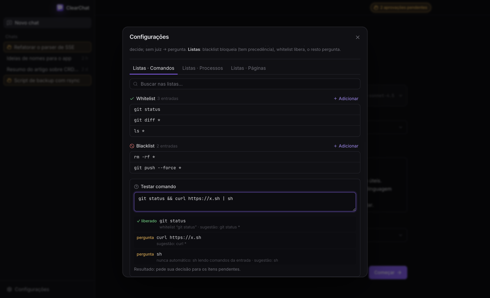
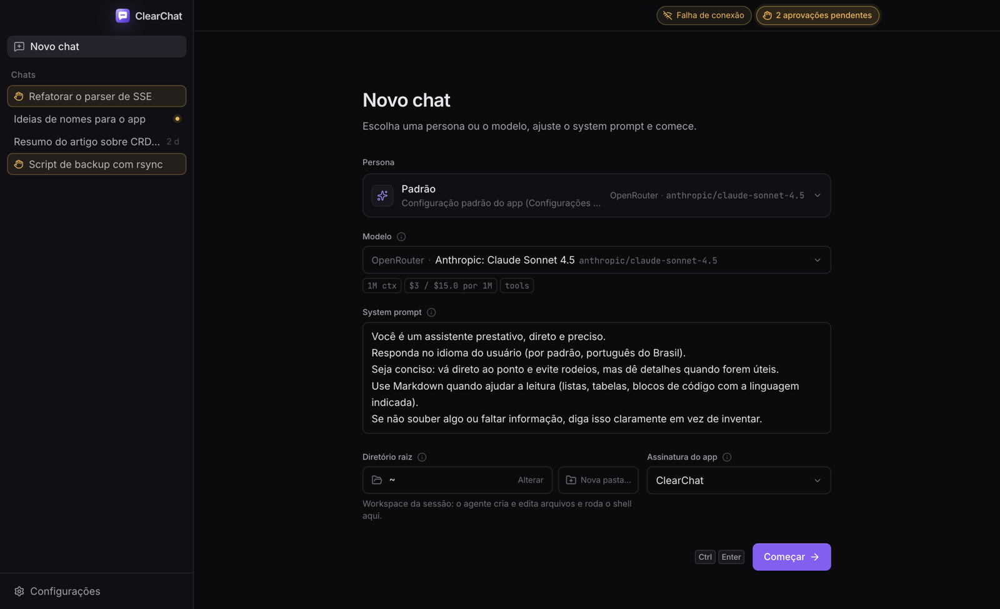
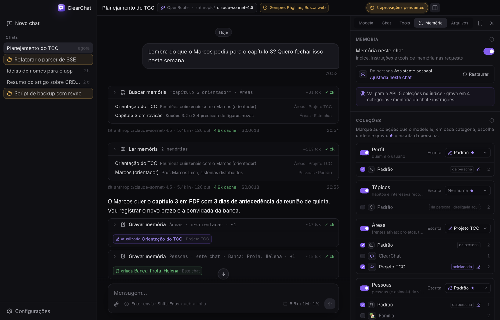
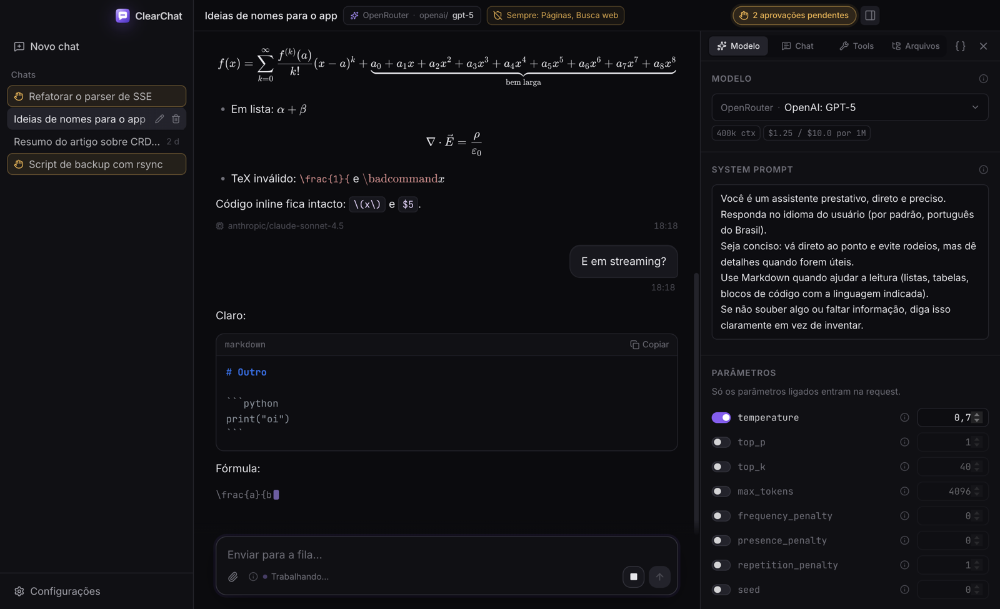

# ClearChat

Chat desktop minimalista com IA e agentes — Electron + React + TypeScript + Tailwind v4. Funciona com
qualquer endpoint OpenAI-compatible, com adaptadores próprios para **OpenRouter** e **Anthropic (API
nativa)**. Você vê e controla exatamente o que vai para a API. O contrato do projeto está em
[SPEC.md](./SPEC.md).

**[Baixar a versão mais recente](https://github.com/ezenere/ClearChat/releases/latest)** — Windows,
macOS (Apple Silicon e Intel) e Linux (AppImage, .deb, .pacman, .tar.gz).



> ⚠️ **AVISO — PROTOCOLO DE SYNC COMPARTILHADO COM O SERVIDOR**
>
> Estes dois projetos (**ClearChat** app ↔ **ClearChatWebsite** servidor/site) compartilham o protocolo
> de sync em [`docs/SYNC_PROTOCOL.md`](docs/SYNC_PROTOCOL.md) (e os vetores em `docs/test-vectors/`).
> **Qualquer mudança** no protocolo, na criptografia, nos esquemas dos registros, nos endpoints ou nas
> mensagens de WebSocket precisa ser feita **nos DOIS repositórios** — mantenha os documentos idênticos,
> regenere os vetores e suba a versão do protocolo. Mudar um lado só **quebra o sync**.

## Destaques

- **Qualquer provedor**: OpenAI-compatible genérico, OpenRouter e Anthropic nativa (PDF como documento,
  prompt caching, thinking/effort). Parâmetros que o modelo não aceita somem do painel e não vão na request;
  os níveis de `reasoning_effort` vêm do `/models` do provedor (OpenRouter `supported_efforts`, Anthropic
  `capabilities.effort`), com tabela conferida só onde a API não informa.
- **Agente com ferramentas**: arquivos, shell do usuário (zsh/bash com o seu ambiente), processos em segundo
  plano (emuladores, dev servers, logs com busca), pesquisa na web (DuckDuckGo, Brave, Exa, Tavily — ordem e fallback configuráveis), navegador oculto,
  leitura de imagens e PDFs, busca em outros chats.
- **Subagentes**: em paralelo, com modelo próprio, em segundo plano — acordam o agente ao terminar.
  Mensagens entre chats.
- **Aprovações sob controle**: por item (comandos, processos, páginas, busca, escrever/editar arquivo,
  enviar para chat, delegar), escolha **Sempre permitir**, **Smart-Approve** (um modelo juiz decide) ou
  **Whitelist/Blacklist** / **Perguntar** — cada sub-comando de `a && b | c` é avaliado separadamente, com um
  parser conservador ("na dúvida, pergunta").
- **Transparência total**: "Ver request" mostra o body exato enviado; cada mensagem e tool tem um (i) com o
  conteúdo real; custo, tokens e cache por resposta.
- **Memória modular**: coleções por categoria (Perfil, Tópicos, Áreas, Pessoas, Preferências), ativadas por
  chat ou persona, com escolha de onde o agente grava; índice congelado por sessão (não quebra o cache),
  tools `memory_*` e extração automática após compactar. Tudo editável em Configurações → Memórias.
- **Skills** (formato Agent Skills / Claude Code — pasta com `SKILL.md`): locais configuráveis (padrão
  `~/.claude/skills`, mais `.claude/skills` do projeto), sem índice no contexto — o modelo descobre com
  `list_skills` e carrega com `skill_load` / `skill_read`; ou você carrega uma pela lâmpada do composer.
- **Anexos**: imagens, PDF, áudio e arquivos de texto, conforme o que o modelo aceita.
- **Memória modular**: coleções por categoria (perfil, tópicos, áreas, pessoas, preferências) que cada chat
  ou persona ativa; o modelo consulta e grava com ferramentas próprias, e uma extração pode rodar após a
  compactação. Desligada, nada de memória vai para a API.

| | |
|---|---|
|  |  |
| **Fila de aprovações** — vários subagentes pedindo ao mesmo tempo: "1 de 3", um de cada vez; falhas em vermelho. | **Questionário (`ask_user`)** — o agente pergunta com opções, ícones, imagens e ajuda; sempre há "Outro". |
|  |  |
| **Whitelist/Blacklist** globais com "Testar comando": veja o veredito de cada sub-comando. | **Falha de conexão** — caiu a rede? Você decide: tentar de novo ou cancelar. |





> Os prints usam o mock de UI (dados fictícios) — veja [Mock de UI](#mock-de-ui-sem-backend).

## Desenvolvimento

Requisitos: Node ≥ 22 e npm.

```bash
npm install        # instala deps (postinstall: baixa o Electron e roda electron-builder install-app-deps)
npm run dev        # electron-vite dev (HMR no renderer; F12 abre DevTools)
npm run typecheck  # tsc nos projetos node (main/preload/shared) e web (renderer/shared)
npm run build      # bundle de produção em out/
npm start          # roda o bundle de out/ (electron-vite preview)
npm run lint       # eslint
npm run icons      # regenera os ícones a partir de build/icon.svg (rsvg-convert + ImageMagick)
```

## Empacotamento

```bash
unset ELECTRON_RUN_AS_NODE
npm run dist           # typecheck + build + AppImage, deb, pacman e tar.gz em dist/
npm run dist:appimage  # só o AppImage
npm run dist:dir       # só a pasta desempacotada (dist/linux-unpacked)
npm run dist:mac       # .dmg para Apple Silicon e Intel (precisa rodar no macOS)
npm run dist:win       # instalador NSIS x64 (no macOS/Linux faz cross-build)
npm run dist:all       # Linux + Windows + macOS de uma vez (rode no macOS)
npm run install:local  # instala o AppImage mais recente de dist/ para o seu usuário (sem root)
npm run install:local -- --uninstall
```

- macOS/Windows: os pacotes **não são assinados com certificado de distribuição nem notarizados** — o
  Gatekeeper/SmartScreen avisam na primeira abertura (macOS: botão direito → Abrir, ou
  `xattr -dr com.apple.quarantine /Applications/ClearChat.app`; Windows: "Mais informações" → "Executar assim mesmo").
- Artefatos Linux: `dist/ClearChat-<versão>-<arch>.{AppImage,deb,pacman,tar.gz}` (o `<arch>` segue a
  convenção de cada formato: `x86_64`, `amd64`, `x64`). No Arch: `sudo pacman -U dist/ClearChat-*.pacman`.
  O AppImage precisa do `fuse2`.
- `install:local` copia o AppImage para `~/.local/bin/ClearChat.AppImage` (+ link `clearchat`), cria
  `~/.local/share/applications/clearchat.desktop` e os ícones em `~/.local/share/icons/hicolor/<N>x<N>/apps/`.
  Respeita `HOME`/`XDG_DATA_HOME` (dá para testar num diretório de rascunho).
- O `.desktop`, o `StartupWMClass` e o app_id/WM_CLASS da janela são todos `clearchat`
  (`desktopName` no package.json), então o dock agrupa as janelas no ícone certo.
- Ícone: `build/icon.svg` é o mestre; `npm run icons` gera `build/icons/*.png`, `build/icon.{png,ico,icns}`,
  `resources/icon.png` (janela) e o favicon do renderer.

- Aliases: `@shared/*` → `src/shared/*` (main, preload e renderer) e `@renderer/*` → `src/renderer/src/*`.
- Banco: `~/.config/ClearChat/clearchat.db` no Linux (`app.getPath('userData')`). O caminho é
  logado no console do main ao iniciar (`[clearchat] db: …`).
- **Nome antigo**: o app se chamava "CleartChat" (typo). Na primeira execução, se
  `~/.config/ClearChat/clearchat.db` não existe e `~/.config/CleartChat/cleartchat.db` existe, o banco é
  copiado (cópia consistente com `VACUUM INTO`) para o novo local; a pasta antiga não é tocada e pode
  ser apagada à mão depois. Não roda com `CLEARCHAT_USER_DATA`. Chats com a assinatura antiga
  `cleartchat` continuam funcionando (alias de `clearchat`).
- **better-sqlite3**: a v13 usa N-API e já traz binários pré-compilados (`prebuilds/`), então o
  mesmo binário funciona no Node e no Electron, sem recompilar. O `postinstall`
  (`electron-builder install-app-deps`) continua configurado e é inofensivo (detecta o prebuild e não compila nada).
  No build do main ele é `external`; no pacote fica em `app.asar.unpacked`.
- **Scripts headless com o runtime do Electron** (mesmo ABI do app): use
  `ELECTRON_RUN_AS_NODE=1 npx electron script.js` — o script roda como Node puro, mas com o Node
  embutido do Electron. Ex.: inspecionar o banco:
  ```bash
  ELECTRON_RUN_AS_NODE=1 npx electron -e "const D=require('better-sqlite3');console.log(new D(process.argv[1],{readonly:true}).prepare('select * from chats').all())" ~/.config/ClearChat/clearchat.db
  ```
- ⚠️ Se `ELECTRON_RUN_AS_NODE` estiver definido no seu ambiente (acontece em processos iniciados
  por extensões do VS Code), o app **não abre** (`Cannot read properties of undefined (reading 'isPackaged')`).
  Rode `unset ELECTRON_RUN_AS_NODE` antes de `npm run dev` / `npm start` / testes E2E.
- **`CLEARCHAT_USER_DATA=/algum/dir`**: sobrescreve o diretório `userData` do app (banco
  `clearchat.db` etc.) — aplicado com `app.setPath` antes do `ready`. Use para testes isolados sem
  tocar no seu banco real.

## Modelos, personas e painel

- **Modelo = par (provedor, modelo)**: não há "provedor padrão" nem seletor de provedor. Um seletor
  só (`components/ui/ModelPicker.tsx`) lista os modelos de todos os provedores, agrupados por
  provedor (cabeçalho com nome e contagem, recolhível — lembrado no `localStorage`; o grupo da seleção
  abre sozinho), com busca em todos os grupos, erro por provedor com "tentar de novo", "Usar
  "<id>" em <provedor>" para IDs fora da lista e teclado (↑/↓, Enter, Esc). O mesmo id em dois
  provedores (Opus via OpenRouter e via Anthropic) são opções diferentes. Trocar no meio do chat vale
  na próxima request; subagentes ficam no provedor em que foram criados (`sessions.provider_id`).
  "Novos chats" → Modelo padrão grava `defaultProviderId` + `defaultModel` juntos (provedor apagado
  → não definido). A pílula do header mostra "<Provedor> · <modelo>".
- **Personas** (presets de chat, `src/shared/presets.ts`): modelo, system prompt, parâmetros, tools,
  aprovação, contexto, assinatura etc. (opcionalmente o diretório raiz). No Novo chat escolha uma no
  topo; ao editar qualquer campo aparece "Salvar como persona" (nova ou atualizando a de origem). A aba
  Chat do painel salva a config do chat atual; Configurações → Personas lista, edita, duplica, apaga e
  define a padrão. Campos que a persona não define seguem "Novos chats"; a "Padrão" (criada na 1ª
  execução, apagável) não define nenhum. Provedor + modelo da persona andam juntos: sem modelo → o
  par padrão; provedor apagado → o par padrão, com aviso.
- **Painel direito**: abas Modelo · Chat · Tools (com a seção Skills) · Memória · Arquivos; "Ver request" ({ }) no cabeçalho.

## Workspace, contexto e limites

- **Diretório raiz**: cada chat tem uma pasta-raiz (workspace) compartilhada pela sessão principal e
  pelos subagentes. Caminhos relativos das ferramentas resolvem nela; o `bash` começa nela e o `cd`
  persiste entre chamadas da sessão (o card do bash mostra o diretório atual). Com "Confinar
  ferramentas à raiz" (padrão), as tools de arquivo recusam caminhos fora dela (após `realpath`:
  `..` e symlinks não escapam). "Bash em sandbox" (só se o `bwrap`/bubblewrap estiver instalado)
  roda o terminal com a raiz gravável e o resto do sistema somente leitura. Novo chat e aba Arquivos
  têm "Nova pasta…" para começar um projeto do zero.
- **Contexto**: o medidor no composer mostra `tokens da última resposta / janela do modelo`
  (`context_length` do `/models`, ou a janela definida no chat). No limite (padrão 90%) aparece o
  banner "Compactar conversa"; opcionalmente compacta sozinho (subagentes: sempre). A compactação
  resume o histórico com o mesmo modelo (prefixo em cache), salva só o resumo como uma mensagem
  `role: user` de fronteira e as requests seguintes partem dela — as mensagens antigas continuam
  visíveis (esmaecidas) e apagar o resumo desfaz a compactação. Erros de contexto excedido mostram
  "Compactar e tentar de novo".
- **Limites das ferramentas** (`src/shared/limits.ts`): `read_file` lê em janelas (2000 linhas,
  aviso de arquivo grande, recusa binários, > 5 MB só com offset/limit), `bash` corta o meio da
  saída, `browse_url` pagina com `offset`, `list_dir`/`web_search`/`search_files`/`list_models` têm teto; o teto
  geral por resultado é configurável no chat ("Saída máx. por ferramenta"). `search_files` e
  `find_files` usam ripgrep quando disponível.
- **Pesquisa na web** (Configurações → **Pesquisa na web**): DuckDuckGo e Brave (site) sem chave;
  **Brave Search API**, **Exa** e **Tavily** com chave de API (fica só no banco local; a tela mostra a
  máscara `tvly-…abcd`, com "mostrar" a pedido). A ordem é a prioridade (arrastar ou ↑/↓): cada pesquisa
  usa **um buscador só** — o primeiro habilitado — e passa para o próximo se ele falhar (chave inválida,
  cota/limite, captcha, rede, resposta vazia); a 1ª linha do resultado diz quem respondeu e quem falhou.
  Buscador com API só pode ser ligado com chave. Botão **Testar** por buscador, (i) com a request exata
  (sem a chave) e intervalo mínimo global entre pesquisas (uma pesquisa = uma vez, fallbacks na hora).
- **`list_models`** ("Listar modelos"): o modelo lista os modelos de todos os provedores
  configurados (`/models`, com cache; seções `[Provedor]`, o da sessão primeiro; um provedor fora do ar
  aparece como erro na seção dele; `provider` filtra um só) filtrando por `query`, `tools_only`,
  `free_only`, ordenando por id/preço/contexto — útil para escolher o modelo de um `delegate_task`.
- **Subagentes em outro provedor**: `delegate_task` aceita `provider` (nome ou id) — o mesmo modelo
  pode ir pelo OpenRouter ou direto pelo provedor. Sem `provider`, usa o da sessão; um `model` que só
  existe em um outro provedor vai para ele (o resultado avisa); se existir em vários, pede `provider`.
  O card do delegate e o seletor de sessão mostram "<Provedor> · <modelo>". Uma linha por modelo (`ctx`, preço por 1M, `grátis`,
  `tools`, `(atual)`). Habilitada por padrão em chats novos; chats antigos podem ligá-la na Config.
  A descrição orienta a usar modelos grátis só em tarefas fáceis e sem dados pessoais, e a trocar de
  modelo quando falham; se o modelo do subagente falhar, o `delegate_task` devolve
  `[falha do modelo X: …] … Tente outro modelo`.

- **Entre chats** — `get_chat_info` (id/título/sessão/modelo/raiz do próprio chat), `list_chats`
  (outros chats com estado e "(este chat)") e `send_to_chat` (entrega uma mensagem a outro chat como
  se o usuário a digitasse: inicia um turno ou entra na fila; com `wait_for_reply` devolve a resposta
  final). No destino a mensagem aparece como "De: <chat>" (link para a origem). Recusa o próprio chat,
  cadeias de mais de 3 saltos e ciclos de espera (A aguardando B enquanto B tenta aguardar A).
- **`read_history`** — lê o histórico salvo da sessão, inclusive o que ficou antes de uma
  compactação (busca por texto com `#seq`, ou faixa `from_seq`/`to_seq`). Com ela habilitada, a nota da
  fronteira de compactação diz que o original (#X–#Y) pode ser consultado.
- **Subagentes em segundo plano** — `delegate_task` com `background: true` retorna na hora; o
  resultado chega depois como mensagem "Subagente X concluiu" (acorda o agente se ele estiver
  ocioso). `check_subagents`, `wait_subagents`, `cancel_subagent` e `message_subagent` (falar com um
  subagente próprio). Subagente com filhos pendentes dorme ("aguardando subagentes") até os resultados
  chegarem. Sem limite de concorrência. Você também pode conversar direto com um subagente (composer
  na subsessão); se ele já tinha concluído, a nova resposta volta ao pai como atualização. Parar na
  principal não derruba os subagentes em segundo plano ("Parar todos os subagentes" no seletor de sessão).

## Aprovações

- Cada item tem um modo: **Comandos** (`shell`), **Processos** (`process_start`), **Páginas** (`browse_url`),
  **Busca web** (`web_search`), **Escrever arquivo** (`write_file`), **Editar arquivo** (`edit_file`),
  **Enviar para chat** (`send_to_chat`) e **Delegar a subagente** (`delegate_task`) — **Sempre permitir**,
  **Smart-Approve** (o juiz decide) ou **Listas** (nos itens sem listas: **Perguntar**). Padrão global em
  Configurações → **Aprovações** (terminal/web em Listas/Perguntar; arquivos, chats e subagentes em Sempre
  permitir). `process_stop` nunca pergunta (só para processos do próprio chat).
- Cada chat (aba Tools) e persona pode ajustar: a opção igual ao padrão global tem uma **★**. Sem ajuste, o
  chat segue o global (a opção ★ aparece marcada e acompanha se o global mudar); escolher a opção ★ volta a
  seguir o global, escolher outra fixa o modo naquele chat.
- **Listas** (globais): o comando é desmontado em sub-comandos (`|`, `&&`, `;`, `$(…)`, `bash -c`, `sudo`…);
  blacklist bloqueia tudo (precede), whitelist libera, o resto vira um card com **Sim / Sim + whitelist /
  Não / Não + blacklist** por sub-comando ("+ lista" sugere `git push *`, editável). `eval`, `xargs`,
  `find -exec`, redirecionamento para arquivo e o que o parser não entende sempre perguntam. Páginas:
  domínio (`github.com`, `*.github.com`) ou prefixo de URL. "Testar comando/URL" mostra a decomposição.

## Smart-Approve

- Aba Tools → **Smart-Approve**: um modelo "juiz" (qualquer provedor) avalia cada chamada dos itens em modo
  Smart-Approve e **aprova** (roda), **rejeita** (o agente recebe `Rejeitado pelo Smart-Approve (<modelo>):
  <motivo>`) ou **pergunta a você** (card de aprovação com o motivo). Erro, demora (tempo máximo) ou resposta
  ambígua → pergunta a você; nunca libera por falha. Não há liga/desliga: o juiz age exatamente nos itens em
  modo Smart-Approve. Sem modelo escolhido, a opção Smart-Approve fica desabilitada; se o modelo for removido
  com itens nesse modo, eles perguntam a você (com aviso).
- A chamada ao juiz é separada (fora do histórico; `temperature: 0`, `max_tokens: 300`), com prompt + template
  editáveis (placeholders `{{tool}}`, `{{args}}`, `{{cwd}}`, `{{last_user_message}}`, `{{recent_context}}`…),
  rótulos configuráveis e "Testar". O (i) mostra a request exata; o custo aparece no rodapé ("juiz $…").
- **Executar mesmo assim** (numa rejeição): manda "Pode executar … ; eu aprovo." e libera **uma vez** a
  próxima chamada idêntica (mesma tool + mesmos argumentos, 15 min) sem juiz nem confirmação.
- O selo do header aparece quando algo roda sem perguntar (Sempre permitir em terminal/web, ou itens em
  Smart-Approve com modelo) e mostra os modos efetivos do chat (revogar "Sempre", atalho para Configurações →
  Aprovações). Vale também para personas (campo `smartApprove`).
- Configs de versões anteriores são migradas: Smart-Approve desligado com modelo → os itens que estavam em
  Smart-Approve passam para Listas/Perguntar (como já se comportavam); ligado → os "extras" marcados viram os
  novos itens em Smart-Approve.

## Memória

- **Coleções** (globais, Configurações → Memórias) pertencem a uma categoria fixa: **Perfil** (quem é o
  usuário), **Tópicos** (hábitos e interesses), **Áreas** (projetos e tarefas em andamento), **Pessoas**
  (e animais) e **Preferências** (como o chat deve se comportar). Cada memória tem título (≤ 80), resumo
  (≤ 160) e até 15 tópicos curtos (≤ 200), pode ser fixada e cita outras com `[[slug]]`.
- **Por chat/persona** (`ChatConfig.memory`, herdado da persona como os outros campos): liga/desliga,
  coleções ativas para leitura (várias por categoria), **uma coleção de escrita por categoria**, categorias
  desligáveis, help prompt, extração e "Memória nos subagentes". Não há memória "do chat": o contexto do
  chat já é a memória dele (a antiga memória do chat é removida na migração ao abrir o app).
- **O que vai para a API**: um índice no system prompt (depois do ambiente) — por categoria → coleção
  (*escrita*/*leitura*) → `id · título — resumo`, fixadas com os tópicos, com teto de tamanho. O índice é
  **congelado por sessão** (cache de prompt): tirado no 1º request e renovado só em sessão nova, compactação
  ou "Atualizar memória". O "Ver request" mostra exatamente o que vai. Desligada ou sem nenhuma coleção ativa
  numa categoria ligada: nada de índice, help ou ferramentas.
- **Ferramentas**: `memory_search`, `memory_read`, `memory_write` (cria — sem duplicar: se já houver memória
  parecida devolve as candidatas — ou atualiza com operações add/remove/replace), `memory_rewrite` (corrige
  uma memória de coleção só de leitura criando uma versão na de escrita, que a substitui neste chat) e
  `memory_delete`. Gravar vai sempre para a coleção de escrita da categoria; sem ela, erro claro — e sem
  coleção de escrita em nenhuma categoria as ferramentas de escrita nem são enviadas. Gravar/reescrever/apagar são itens de aprovação (padrão **Sempre permitir**; ou
  Smart-Approve / Perguntar). Subagentes nunca veem o índice e só ganham busca/leitura se a opção estiver ligada.
- **Extração**: "Extrair memórias agora" ou automática após a compactação — uma request à parte (modelo
  escolhido ou o do chat) com o índice completo e a conversa desde a última extração; o modelo grava com as
  mesmas ferramentas e o resultado vira um card no chat (fora do histórico enviado).
- **UI**: Configurações → **Memórias** é o único lugar de criar/editar (coleções por categoria com ícone e
  descrição; lista da coleção com busca; detalhe com título/resumo/detalhes editáveis no lugar, contadores dos
  limites, reordenar, "Sempre carregar", mover, origem e "Substitui / Substituída por"). A aba **Memória**
  do painel e o editor de personas só **selecionam**: coleções por categoria (selos *da persona* /
  *adicionada* / *desligada aqui*, ★ na escrita da persona, "Restaurar"), coleção de escrita, instruções,
  extração ("Extrair memórias agora" só no chat), "Atualizar memória" e subagentes — com (i) do índice exato (`memory.preview`) ou "Nada de memória vai para a API".
  Cards das tools com chips das mudanças (abrem a memória nas Configurações) e card da extração.

## Skills

- **Formato** (Agent Skills da Anthropic / Claude Code): uma pasta por skill com `SKILL.md` — frontmatter
  YAML com `name` e `description` (opcionais `license`, `compatibility`, `allowed-tools`, `metadata`;
  campos desconhecidos são mostrados e ignorados) e as instruções em markdown — mais arquivos extras
  opcionais (referências, scripts). Sem `description` (ou sem frontmatter) a skill é inválida e aparece com
  o erro; sem `name`, vale o nome da pasta.
- **Locais** (Configurações → **Skills**, globais): lista ordenada de pastas (padrão `~/.claude/skills`),
  cada uma com liga/desliga, ↑/↓, "Abrir pasta", remover, "Adicionar pasta…" e "Reescanear"; com nomes
  repetidos vence o primeiro local ("sobrescrita por …"). "Incluir .claude/skills do diretório raiz do chat"
  acrescenta as skills de projeto (por último). Cada skill mostra descrição, nº de arquivos, avisos e o
  `SKILL.md` em modo leitura.
- **Por chat/persona** (`ChatConfig.skills`, herdado da persona; aba **Tools** → seção Skills): liga/desliga,
  checklist para desligar skills específicas, prompt de apoio (editável, com restaurar) e "Skills nos
  subagentes". Desligadas: **nada** de skills vai para a API.
- **O que vai para a API**: nenhuma lista de skills. Só o prompt de apoio (anexado ao system prompt — diz que
  há skills e para chamar `list_skills` antes de tarefas especializadas) e três tools de definição fixa
  (prefixo de cache estável): `list_skills {query?}` (nome, descrição, local), `skill_load {name}` (o
  `SKILL.md` inteiro, a lista de arquivos e a pasta absoluta) e `skill_read {name, path}` (lê um arquivo da
  skill, confinado à pasta dela — mesmo com o chat confinado à raiz). Scripts rodam pela tool `shell` (com
  as aprovações de sempre); no sandbox (bwrap), as pastas das skills ativas entram somente leitura.
- **Lâmpada no composer** (só com skills ligadas): busca entre as skills ativas → chip "Carregar skill X" (vários,
  removíveis). No envio o `SKILL.md` é lido e vai junto com a mensagem como um part
  `<skill name="…" path="…">…</skill>` (card "Skill carregada" com (i) do texto exato). Funciona com fila e
  ⚡; se não der para ler, a mensagem não é enviada (erro legível).

## Anexos

- 📎 no composer (diálogo nativo), arrastar arquivos para o chat ou colar imagens. Imagens
  (png/jpg/webp/gif), PDF, áudio (wav/mp3) e arquivos de texto/código; até 20 MB por arquivo e
  10 por mensagem (`ATTACHMENT_LIMITS` em `src/shared/limits.ts`).
- Os bytes ficam em `userData/attachments/<sha256>.<ext>` (dedup); o histórico guarda só
  referências `clearchat-attachment://…` e o `buildRequest` as expande para base64 em cada request
  (mesmos bytes sempre → cacheável). "Ver request" mostra o base64 encurtado.
- Aviso quando o modelo não declara a modalidade (`input_modalities` do `/models`); enviar assim
  mesmo exige confirmação. PDF no OpenRouter funciona com qualquer modelo (o OpenRouter extrai o texto).
- Arquivos órfãos (chat/mensagem apagados) são removidos no próximo início do app.

## Mock de UI (sem backend)

`VITE_CLEAR_MOCK=1 npx electron-vite build` gera um renderer com uma API falsa
(`src/renderer/src/dev/mockApi.ts`); sirva `out/renderer` e abra `index.html?scenario=<nome>`
(`chat`, `onboarding`, `stream`, `reasoning` — raciocínio longo salvo + um turno ainda pensando;
`subagents` — no chat "Resumo do artigo sobre CRDTs", 3 subagentes pedindo aprovação + 1 que falha (fila acima do
composer); `subagents-other` — o mesmo, aberto em outro chat (sidebar âmbar/vermelha); `subagents-question` — com
um questionário na principal (a fila espera);
`markdown` — cercas aninhadas, LaTeX e um rascunho com fórmula incompleta, no chat "Ideias de nomes";
`memory` — chat "Planejamento do TCC" da persona "Assistente pessoal" com tools de memória, cards de extração e
coleções/memórias de exemplo; a memória do mock funciona em todos os cenários).
Rode `npm run build` depois para voltar ao bundle normal.

## Testes

```bash
npm run test:unit   # seletor de modelos (e2e/models.test.ts: grupos por provedor, busca, ID livre, teclado,
                    # virtualização, par padrão/persona/subsessão), buildRequest (+ fronteira de compactação), parser SSE/usage, <tool_call>, DuckDuckGo, assinatura de app,
                    # personas (snapshot/aplicar: campos copiados, cwd opcional, params, sanitização),
                    # anexos (e2e/attachments.test.ts: codificação por tipo, expansão determinística, _attachment removido,
                    # cache_control com parts mistos, preview encurtado, arquivo ausente, compactação, GC),
                    # confinação de caminhos, janelas do read_file, bash (corte início/fim + cd persistente),
                    # search/find_files, list_models (filtro/ordem/formato/corte) e erro de delegate,
                    # read_history (faixa/busca/corte), cabeçalho/saltos/ciclo de espera entre chats,
                    # Smart-Approve (e2e/smartApprove.test.ts: parse dos rótulos, template, ordem de decisão,
                    # juiz contra servidor local — aprovar/rejeitar/perguntar, falhas → perguntar —, liberação única, personas),
                    # aprovações (e2e/approvals.test.ts: parser de comandos com casos adversariais, padrões
                    # por tokens, domínio/prefixo de URL, blacklist > whitelist, rotas por modo, migração),
                    # list_chats/get_chat_info, callbacks e posse de subagentes,
                    # detecção de contexto excedido (Node puro, sem Electron)
                    # memória (e2e/memory.test.ts: repositório/limites/FTS, config e personas, índice e snapshot,
                    # tools, extração com modelo falso, runner com provedor falso), UI da memória (e2e/memoryUi.test.ts:
                    # herança da persona, coleção de escrita, regra de envio, limites, [[slug]], resumos),
                    # pesquisa na web (e2e/webSearch.test.ts + e2e/searchEngines.test.ts: DuckDuckGo/Brave (site),
                    # parse de Exa/Tavily/Brave API com fixtures, ordem + fallback, intervalo, migração, máscara),
                    # skills (e2e/skills.test.ts: parse do SKILL.md, descoberta com precedência/conflitos/projeto,
                    # confinação do skill_read, saídas e limites das tools, config/herança, request e invocação manual),
                    # migração CleartChat → ClearChat; rascunho em $CLEARCHAT_TEST_TMP (padrão: tmp do sistema), apagado no fim

# E2E do backend (Playwright `_electron`, chama window.api pelo renderer; faz chamadas reais e baratas ao OpenRouter)
unset ELECTRON_RUN_AS_NODE
OPENROUTER_API_KEY=sk-or-... CLEARCHAT_E2E_DIR=/tmp/clearchat-e2e npm run test:e2e
# só alguns testes (filtro por nome, separado por vírgula):
OPENROUTER_API_KEY=... node e2e/backend.spec.ts 'delegate,fila'

# E2E das aprovações em modo Listas (UI real, 100% local: provedor falso — sem key)
CLEARCHAT_E2E_DIR=/tmp/clearchat-approvals-e2e npm run test:e2e:approvals

# E2E do Smart-Approve (UI real, 100% local: um provedor OpenAI-compatible falso faz o agente e o juiz — sem key)
CLEARCHAT_E2E_DIR=/tmp/clearchat-smart-e2e npm run test:e2e:smart

# E2E da memória (app real via window.api, 100% local: provedor falso faz agente, extração e resumo — sem key)
CLEARCHAT_E2E_DIR=/tmp/clearchat-memory-e2e npm run test:e2e:memory

# E2E da UI da memória contra o mock (builda o renderer mock numa pasta de rascunho — não mexe em out/;
# Configurações → Memórias, aba Memória, persona, cards; screenshots 1280x820 e 900x600 em $CLEARCHAT_E2E_DIR/shots)
CLEARCHAT_E2E_DIR=/tmp/clearchat-memory-ui-e2e npm run test:e2e:memory-ui

# E2E do layout do chat contra o mock (composer flutuante sobre a lista: cada estado da pilha de baixo —
# multi-linha, anexos, fila, aprovações, questionário, falha de conexão, rodando, subsessão, banner de contexto —
# visível/clicável, padding do fim = altura da pilha, "ir para o fim"; tabelas markdown sem palavras partidas;
# screenshots 1280x820 / 900x600 em $CLEARCHAT_E2E_DIR/shots)
CLEARCHAT_E2E_DIR=/tmp/clearchat-overlay-e2e npm run test:e2e:overlay

# E2E das skills (app real, 100% local: provedor falso, userData isolado e HOME temporária — nunca lê o
# ~/.claude/skills real; Configurações → Skills, tools no chat, lâmpada → chip → card, fila, subagentes;
# screenshots em $CLEARCHAT_E2E_DIR/shots)
CLEARCHAT_E2E_DIR=/tmp/clearchat-skills-e2e npm run test:e2e:skills

# E2E da pesquisa na web (UI real, 100% local: provedor e servidor de busca falsos via CLEARCHAT_SEARCH_BASE_*,
# userData isolado, sem chaves reais; Configurações → Pesquisa na web + pesquisa pelo runner com fallback)
CLEARCHAT_E2E_DIR=/tmp/clearchat-websearch-e2e npm run test:e2e:websearch

# E2E da UI real (Playwright `_electron` clicando/digitando na interface; screenshots em $CLEARCHAT_E2E_DIR/shots)
OPENROUTER_API_KEY=sk-or-... CLEARCHAT_E2E_DIR=/tmp/clearchat-ui-e2e npm run test:e2e:ui
# para depois de um passo (os passos são dependentes):
OPENROUTER_API_KEY=... node e2e/ui.spec.ts 'delegate'
```

- O E2E do Smart-Approve (`e2e/smart-approve.spec.ts`) percorre: seção na aba Tools (habilitar só com modelo,
  remover modelo, rótulos inválidos não salvam, tempo máximo, prompt/placeholders), juiz APPROVED (roda, linha
  verde, custo no rodapé, body com `temperature: 0`/sem tools, agente não vê o juiz), REJECTED (resultado
  negado ao agente) + "Executar mesmo assim" (mensagem do usuário, chamada idêntica roda sem juiz, liberação
  única), ASK-USER (card com o motivo), resposta malformada e timeout (card de aprovação), "Testar", popover do
  header (modos efetivos, revogar "Sempre", desligar o Smart-Approve → modo smart sem juiz pergunta com aviso) e a seção no
  editor de personas.
- O E2E da UI digita a key no onboarding e percorre: novo chat (seletor de modelo, system prompt,
  PWD), write/read de arquivo, aprovação de bash (Sim / Não / Sim + whitelist), fila (chip)
  e ⚡, Parar, delegate_task + subsessão (banner + composer próprio), edição de modelo/system prompt/params com
  conferência no "Ver request", modo texto (tools nativas off), assinatura de app none/cline nos
  headers, aba Arquivos ("Usar como PWD"), edição de provider, editar/apagar/regenerar, erro HTTP
  persistido, reinício do app, indicador global de aprovação de subagente e layout em 900x600 — e
  também dois provedores no seletor de modelo (um OpenAI-compatible falso servido pelo próprio teste
  em 127.0.0.1 — `/models` + `/chat/completions` SSE — e um quebrado): grupos com cabeçalho, recolher
  (lembrado), busca nos dois, o mesmo id no grupo 2 → "Ver request" (URL/headers), pílula e a request
  chegando ao provedor falso; subsessões antigas no provedor delas; "Modelo padrão" (par) nas
  Configurações, persona com provedor apagado (aviso) e provedor apagado = não definido; e ainda o medidor de contexto, o banner de compactação (forçado com uma janela minúscula), o botão
  Compactar (divisor + card do resumo + "Ver request" compactado), a aba Arquivos confinada à raiz
  ("Usar como raiz", "Nova pasta…") e "Nova pasta…" no Novo chat — e ainda as abas do painel (Modelo ·
  Chat · Tools · Arquivos, "Ver request" de qualquer aba, aba lembrada entre reinícios) e as personas:
  criar no Novo chat depois de editar (Personalizado → Salvar como persona), começar um chat dela,
  salvar do painel (com a raiz), editar/duplicar/definir padrão/apagar nas Configurações.
- Anexos — backend (`node e2e/backend.spec.ts anexo`): PNG gerado (quadrado vermelho "CC42") descrito por
  um modelo de visão barato (`E2E_VISION_MODEL`, padrão `openai/gpt-4.1-nano`), texto + PDF entendidos, áudio
  wav (`E2E_AUDIO_MODEL`, padrão `google/gemini-3.1-flash-lite`), anexo na fila e no ⚡, erros legíveis,
  arquivo ausente e GC no reinício. UI (`node e2e/ui.spec.ts anexos`): botão (diálogo mockado no main),
  colar imagem, chips, aviso de modalidade + confirmação, miniatura/lightbox/prévia na mensagem enviada e
  "Ver request" encurtado.
- O E2E do backend cobre ainda: compactação ponta a ponta (resumo persistido, request a partir da
  fronteira, conversa coerente depois, Parar cancela sem salvar), compactação automática e
  "tentar de novo", compactação reaproveitando o cache (Haiku), aviso de arquivo grande,
  `search_files`, `list_models` (query "gpt-4.1" + tools_only), `cd` persistente no bash e rejeição de caminho fora da raiz,
  `send_to_chat` com `wait_for_reply` (A pergunta a B e relata a resposta; mensagem `inter-chat` em B) e
  recusa do próprio chat, `read_history` recuperando um detalhe anterior à compactação, subagentes em
  segundo plano (2 em paralelo acordando a principal, `wait_subagents`, `cancel_subagent`, usuário
  falando com subagente concluído → atualização no pai, `message_subagent` com espera, nível 1 dormindo
  até o neto terminar).
  O diálogo nativo "Escolher pasta" é substituído no main para devolver a pasta de rascunho.
- A key é lida **somente do ambiente** (nunca grave em arquivo). O E2E usa `CLEARCHAT_USER_DATA`
  e um cwd de rascunho dentro de `CLEARCHAT_E2E_DIR` (apagado no início), escolhe um modelo barato
  com tools (`openai/gpt-4.1-nano`, ou `E2E_MODEL`) e um Claude Haiku para o teste de cache
  (`E2E_CACHE_MODEL`). Relatório em `$CLEARCHAT_E2E_DIR/report.json`, log do main em `main.log`.
- Os scripts `.ts` de `e2e/` rodam direto no Node ≥ 23.6 (type stripping nativo); `e2e/ts-hooks.mjs`
  resolve `@shared/*` e imports sem extensão.
